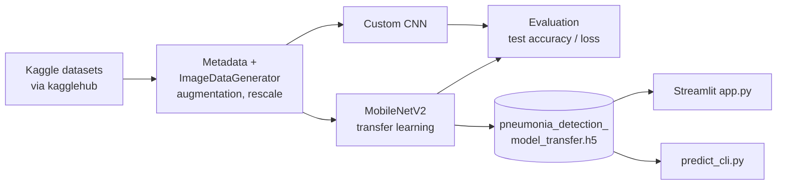
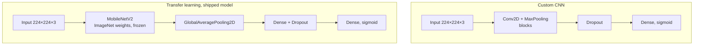

# Pneumonia Detection from Chest X-rays (CNN & Transfer Learning)

Binary image classifier (`NORMAL` vs `PNEUMONIA`) built with **TensorFlow/Keras**. It compares a custom CNN trained from scratch with a **MobileNetV2 transfer-learning** model, and ships a **Streamlit** demo and a command-line predictor.


> **Disclaimer:** research and demonstration project only. It is not a medical device and must not be used for diagnosis.

## Results

Metrics are copied from the saved outputs of `CNN_Project.ipynb`. Training ran for 10 epochs, batch size 32, input 224×224×3.

| Model | Dataset | Test accuracy | Test loss |
|---|---|---|---|
| Custom CNN | `mitgandhi10/dataset-for-cnn` (small) | 0.950 | 0.271 |
| MobileNetV2 transfer (frozen base, shipped model) | `paultimothymooney/chest-xray-pneumonia` (larger) | 0.894 | 0.243 |

How to read this honestly:

- **The two rows are not comparable.** They use different datasets and different test sets. The custom CNN's higher number comes from a very small dataset and says little about generalisation. The transfer model's test set is larger, so its figure is the more trustworthy one.
- **Accuracy alone is not enough for a medical task.** Precision, recall (sensitivity) and a confusion matrix are not computed yet. They are the first thing to add.
- The notebook's own summary cell quotes 0.975 accuracy for the first model, while the evaluation cell shows 0.950. These come from different runs; the table uses the evaluation cell's output.

## Architecture

End-to-end flow:



The two models:



## Approach

1. Download datasets with `kagglehub` and build labelled image metadata.
2. Augment training images with `ImageDataGenerator`; rescale only for validation and test.
3. Train a custom CNN (`Conv2D` + `MaxPooling2D` blocks, `Dropout`, sigmoid output).
4. Build a transfer-learning model: `MobileNetV2` (ImageNet weights, frozen) + `GlobalAveragePooling2D` + `Dense` + `Dropout`.
5. Evaluate on held-out test images and save the model as `pneumonia_detection_model_transfer.h5`.

## Quickstart

```bash
pip install -r requirements.txt

# Command-line prediction on a single image
python predict_cli.py --image path/to/xray.jpg

# Streamlit demo: upload an image, get a prediction
streamlit run app.py
```

`predict_cli.py` loads `pneumonia_detection_model_transfer.h5` by default (`--model` overrides it) and prints the label and confidence. An output above 0.5 is `Pneumonia`.

To retrain, open `CNN_Project.ipynb` in Jupyter or VS Code and run the cells in order. Dataset download via `kagglehub` needs internet access and a configured Kaggle account.

## Repository layout

```
CNN_Project.ipynb                       training and evaluation notebook
app.py                                  Streamlit demo app
predict_cli.py                          single-image CLI inference
pneumonia_detection_model_transfer.h5   trained transfer-learning model (about 11 MB)
data/dataset_setup.py                   checks a local train/val/test folder layout
requirements.txt                        dependencies
```

Expected local dataset layout (checked by `data/dataset_setup.py`):

```
data/{train,val,test}/{NORMAL,PNEUMONIA}/
```

## Limitations and next steps

- [ ] Add precision, recall, F1 and a confusion matrix, and report sensitivity separately.
- [ ] Pin dependency versions in `requirements.txt` (currently unpinned).
- [ ] Fine-tune the top MobileNetV2 layers and compare.
- [ ] Add tests and CI.
- [ ] Move training logic out of the notebook into a script with a fixed random seed.

## Data

Training data comes from public Kaggle datasets (`mitgandhi10/dataset-for-cnn`, `paultimothymooney/chest-xray-pneumonia`). No images are stored in this repository. Check each dataset's licence on Kaggle before reuse.
